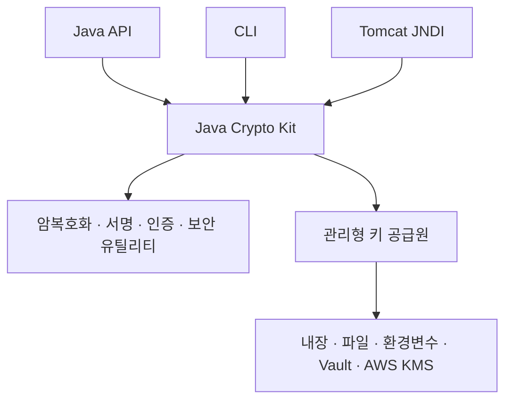

# Java Crypto Kit (JCK)

**기존 Java 시스템의 보안 적용부터 신규 서비스의 암호화·인증 기능 개발까지.**

Java Crypto Kit(JCK)는 실무에 필요한 암복호화, 전자서명, 인증 토큰, 키 관리 기능을 **Java API와 실행형 CLI**로 제공하는 오픈소스 보안 라이브러리입니다.

기존 Tomcat JNDI 기반 시스템에 업무 소스 변경 없이 DB 접속정보 암호화를 적용하고, 별도의 테스트 프로그램 없이 CLI에서 보안 기능을 직접 체험할 수 있습니다.

**Java 8 이상 · 기본 JAR 1개 · 프레임워크 독립 · Apache License 2.0**

[**JAR 다운로드 (v0.2.1)**](https://github.com/UtiliLabs/java-crypto-kit/releases)　|　[빠른 시작](#api-cli-빠른-시작)　|　[제공 기능](#제공-기능과-업무-적용)　|　[전체 사용자 가이드](docs/user-guide.md)

<br>

<a name="주요-특징"></a>
## 1. 왜 JCK인가?

### 기존 시스템을 크게 변경하지 않아도 됩니다

Java 8 이상에서 동작하며 특정 프레임워크에 의존하지 않습니다. 기본 보안 기능은 JDK 기반의 JAR 하나로 사용할 수 있어 별도 라이브러리 설치 부담을 줄일 수 있습니다.

기존 Tomcat JNDI 기반 시스템은 JAR 배치와 Resource 설정 변경으로 업무 코드의 JNDI 조회 방식을 유지할 수 있습니다.

### 코드 작성 없이 먼저 검토할 수 있습니다

실행형 CLI에서 암복호화, 서명, 해시, JWT, OTP 등의 실제 보안 기능을 시험할 수 있습니다.

도입 전에는 기능과 입출력 형식을 검토하고, 도입 후에는 암호문 준비, 키 관리, 개발 결과 검증에 활용할 수 있습니다.

### 필요한 보안 기능만 선택해서 사용할 수 있습니다

관리형 암복호화와 독립 Java API를 제공하므로 애플리케이션이 보유한 암호화 키, 신뢰할 서명 키, 검증 정책을 직접 전달할 수 있습니다.

내장·파일·환경변수·Vault·AWS KMS 등 운영 환경에 맞는 키 공급원을 선택할 수 있으며, 이전 키를 유지하면 키 교체 전의 관리형 암호문도 읽을 수 있습니다.

Apache License 2.0의 조건에 따라 상용 및 오픈소스 프로젝트에 활용할 수 있습니다.

<br>

<a name="이런-업무에-활용할-수-있습니다"></a>
## 2. 어떤 업무에 활용할 수 있나요?

| 업무 | 활용 방법 |
|---|---|
| DB 접속정보 보호 | Tomcat JNDI 암호화 연동 |
| 업무 데이터·파일 보호 | 문자열·파일 암복호화 |
| API 요청 위변조 검증 | HMAC·전자서명·요청 서명 |
| 서비스 인증 기능 개발 | 비밀번호 해시·JWT·OAuth·OTP |
| 보안 기능 사전 검토 | CLI로 실제 기능 실행 및 검증 |
| 운영 키 관리 | 키 등록·교체·백업·외부 키 연동 |

<br>



<br>

<a name="api-cli-빠른-시작"></a>
## 3. 빠른 시작

Java 8 이상이 설치된 환경에서 [배포 JAR](https://github.com/UtiliLabs/java-crypto-kit/releases)를 다운로드하세요.

Windows와 Linux 모두 JAR가 있는 폴더에서 동일한 명령을 실행합니다.

### Step 1. 도움말 확인

최초 설정 없이 지원 기능과 명령을 확인할 수 있습니다.

```bash
java -jar java-crypto-kit-0.2.1.jar help
```

### Step 2. 최초 관리자 설정

공식 배포 SHA-256을 설정 전에 비교하세요. 배포 원본에는 암호화 키가 없으며 최초 설정 시 관리자 비밀번호를 두 번 입력하면 독립적인 무작위 Passphrase와 AES 키가 생성됩니다.

```bash
java -jar java-crypto-kit-0.2.1.jar admin setup
```

### Step 3. 암호화

DB 비밀번호 등의 값을 숨김 입력하면 기본 `pass` 키로 암호화합니다.

```bash
java -jar java-crypto-kit-0.2.1.jar enc
```

### Step 4. 복호화 또는 검증

관리자 인증 후 생성한 암호문 한 줄 전체를 입력합니다.

```bash
# 평문 복원
java -jar java-crypto-kit-0.2.1.jar dec

# 평문을 표시하지 않고 암호문 검증
java -jar java-crypto-kit-0.2.1.jar verify
```

> **최초 설정 및 운영 시 참고**
>
> 최초 설정 후에도 JAR 파일명과 경로는 유지됩니다. 내부 설정이 갱신되므로 공식 배포 SHA-256과 달라지는 것이 정상입니다. 작업자 옵션을 생략하면 `SYSTEM`으로 기록합니다.
>
> 설정 JAR를 안전하게 백업하고 같은 암호문을 읽는 서버에 동일한 키와 ID를 배치하세요. 내장 Passphrase 원문은 사후 조회할 수 없으므로 원문이 필요한 경우 최초 설정 시 `--pass-export`로 보호된 복원 파일을 생성하세요.

[CLI 첫 실행 안내](docs/guide/cli.md#topic-cli-encryption--첫-실행-예제)　|　[배포 파일과 사용 준비](docs/reference/getting-started.md)

<br>

## 4. 적용 방식 선택

<a name="cli--코드-없이-암호화-및-키-관리"></a>
<a name="cli--코드-없이-보안-기능-체험-및-운영"></a>
### CLI — 보안 기능 체험 및 운영

별도 Java 테스트 프로그램 없이 실제 보안 엔진을 호출합니다. 가상 결과를 생성하는 전용 시뮬레이터가 아니라 실제 암호화·서명·검증 기능을 실행하는 도구입니다.

- **개발 및 검증:** 암복호화, 해시, 전자서명, HMAC, 요청 서명, 토큰, OTP, 인코딩, 키 생성·변환, 인증서 정보 등

- **운영 관리:** 암호문 준비, 파일 암복호화, 키 생성·등록·조회·백업·복구·교체, JAR 설정 및 진단

최초 관리자 설정과 명령별 인증·민감 결과 보호 정책을 따릅니다. 파일 암복호화에는 결과 경로(`--out`)를 지정하며 외부 시스템 시험에는 해당 환경이 필요합니다.

[전체 CLI 명령·옵션](docs/guide/cli.md#topic-cli--22-명령-목록)　|　[파일 처리](docs/guide/file-encryption.md)

<br>

<a name="tomcat--jdbc-접속정보-암호화-연동"></a>
<a name="tomcat--업무-코드-변경-없는-jdbc-접속정보-암호화"></a>
### Tomcat — 업무 코드 변경 없는 DB 접속정보 보호

기존 JNDI Resource의 DB 접속정보를 암호문으로 변경하면 JCK Factory가 복호화하여 공식 Connection Pool에 전달합니다.

1. CLI에서 `pass` 또는 `key`로 암호문을 준비합니다.
2. 같은 키를 사용할 수 있는 JCK JAR·설정과 JDBC 드라이버를 Tomcat에 배치합니다.
3. JNDI Resource 설정을 변경하고 기존 업무 코드의 JNDI 조회 방식을 유지합니다.

DBCP2와 Tomcat JDBC Pool을 지원합니다. Resource별 `cryptoPool` 설정으로 같은 Context 안에서도 두 Pool을 함께 사용할 수 있습니다.

[**Tomcat JDBC 연동 전체 절차 및 두 Pool 설정 예제**](docs/guide/tomcat-jdbc.md)

<br>

<a name="java-api--애플리케이션에서-보안-기능-호출"></a>
### Java API — 애플리케이션 보안 기능 개발

관리형 API로 CLI·Tomcat과 동일한 암호문을 처리하거나, 독립 API에 애플리케이션의 키를 직접 공급할 수 있습니다.

독립 API와 명시적 외부 키를 사용하는 Java·Tomcat은 CLI 관리자 등록 없이 사용할 수 있습니다. 입력 키, 신뢰 키, 검증 정책은 호출자가 준비해야 합니다.

[Java API 선택 기준](docs/reference/api-selection.md)　|　[암복호화 예제](docs/guide/java-encryption.md)

[메서드·Builder·반환값](docs/reference/java-api-reference.md#api-members)

<br>

<a name="제공-기능과-업무-적용"></a>
## 5. 제공 기능

### 암호화 및 데이터 무결성

| 기능 | Java API | CLI |
|---|---|---|
| 관리형 문자열·파일 암복호화 | [CredentialCrypto](docs/guide/java-encryption.md#topic-java-api) | [문자열](docs/guide/cli.md#topic-cli) · [파일](docs/guide/file-encryption.md) |
| 직접 키·Passphrase, AES-GCM·RSA-OAEP·Hybrid | [암복호화 API](docs/guide/java-encryption.md) | [`api aes`, `api rsa`, `api hybrid`](docs/guide/java-encryption.md#api-cli-guide) |
| 체크섬·전자서명·HMAC·요청 서명 | [무결성 API](docs/guide/data-integrity.md) | [검증 명령](docs/guide/data-integrity.md#api-cli-guide) |

독립 AES API는 AES-128/256 및 AAD를 지원합니다.

### 인증 및 보안 유틸리티

| 기능 | Java API | CLI |
|---|---|---|
| OTP·JWT·JWKS·OAuth 2.0 | [인증 API](docs/guide/authentication.md) | [토큰·OTP 명령](docs/guide/authentication.md#api-cli-guide) |
| 비밀번호 해시·난수·키 파생·인코딩 | [유틸리티 API](docs/guide/security-utilities.md) | [유틸리티 명령](docs/guide/security-utilities.md#api-cli-guide) |
| 키 생성·변환, X.509 인증서 정보 | [키·인증서 API](docs/guide/certificates-keystores.md) | [키 생성](docs/guide/key-management.md#api-keygen) · [변환·인증서](docs/guide/certificates-keystores.md#api-cli-guide) |
| PKCS12/JKS 읽기·PKIX 검증·안전 비교 | [키 저장소](docs/guide/certificates-keystores.md) · [안전 비교](docs/guide/security-utilities.md#topic-encoding) | — |

### 운영 및 연동

| 기능 | Java API / 연동 | CLI |
|---|---|---|
| 키 등록·백업·교체, Vault·KMS | [키 공급원 설정](docs/guide/external-key-providers.md) | [키·설정 관리](docs/guide/key-management.md) |
| Tomcat JDBC | [JNDI Factory](docs/guide/tomcat-jdbc.md) | [암호문 준비](docs/guide/cli.md#topic-cli-encryption--첫-실행-예제) |

<br>

<a name="암호화-방식과-키-선택"></a>
## 6. 암호화 및 키 관리

관리형 암복호화는 두 가지 키 준비 방식을 제공합니다. 두 방식 모두 **AES-256-GCM**을 사용하며 서로 다른 암호 알고리즘이 아닙니다.

| 방식 | 특징 |
|---|---|
| `pass` | Passphrase에서 PBKDF2로 AES 키 파생 |
| `key` | 32바이트 AES 키 직접 사용 |

### 키 공급원

JAR 내장, 파일, 환경변수, Vault, AWS KMS 중 운영 환경에 맞는 방식을 선택할 수 있습니다.

관리형 암호문에는 키 ID가 기록됩니다. 서버에 이전 키를 유지하면 키 교체 전후의 데이터를 함께 읽을 수 있습니다.

[키 유형·공급원 선택 및 관리](docs/guide/key-management.md#choose-key-material)

[사용자 지정 키 등록 및 이전](docs/guide/key-management.md#topic-key-selection)

<br>

<a name="다운로드"></a>
<a name="지원-환경"></a>
## 7. 다운로드 및 지원 환경

[**GitHub Releases에서 JAR 다운로드**](https://github.com/UtiliLabs/java-crypto-kit/releases)

기본 보안 기능은 JAR 하나로 사용할 수 있습니다. Tomcat 연동에는 JDBC 드라이버 및 해당 Pool 환경이 필요하며, AWS KMS 사용 시에는 선택 SDK를 추가합니다.

### 호환성 및 검증 이력

| 구분 | 지원 및 검증 범위 |
|---|---|
| Java | Java 8 이상 · JDK 8/21/25 실행 검증 |
| 빌드 | Gradle 8.14.8 · JDK 8~24 (Gradle 지원 범위) |
| Tomcat | 9.0 / 10.1 / 11.0 · 8.5 레거시 검증 |
| Connection Pool | DBCP2 / Tomcat JDBC Pool · MariaDB 실연동 |
| 외부 연계 | Vault·Keycloak 실연동 · AWS KMS 모의 시험 |

위 검증 범위는 기존 개발·시험 이력입니다. AWS KMS 실계정 검증 및 최신 공개 JAR 기준 독립 Tomcat·DB 실연동 검증은 별도 확인이 필요합니다.

[상세 호환성 및 검증 범위](docs/reference/compatibility.md)

> 이 문서는 소스 버전 0.2.1 기준입니다. 다른 버전은 해당 릴리스 문서를 참고하세요. 받은 JAR의 버전은 최초 설정 전에도 `help` 출력의 첫 줄에서 확인할 수 있습니다.

<br>

<a name="문서-및-개발"></a>
## 8. 문서 및 개발

[**전체 사용자 가이드**](docs/user-guide.md) — 업무별 상세 목차와 사용 방법

### 사용자 및 운영자

| 문서 | 내용 |
|---|---|
| [설정 사전](docs/reference/configuration.md) | 설정 항목 및 기본값 |
| [오류 해결](docs/reference/troubleshooting.md) | 오류 원인 및 해결 방법 |
| [보안 및 운영 참고](docs/reference/security.md) | 안전한 적용 및 운영 지침 |

### 개발자

| 문서 | 내용 |
|---|---|
| [Java API 공통 규칙](docs/reference/java-api-reference.md) | API 사용 규칙 및 참조 |
| [기술 명세](docs/reference/technical-specification.md) | 기능 및 기술 설계 |
| [소스 빌드 안내](docs/reference/getting-started.md#topic-getting-started--12-준비물과-내려받기) | 빌드 환경 및 절차 |
| [변경 이력](CHANGELOG.md) | 버전별 변경 사항 |
| [개발·QA 규칙](AGENTS.md) | 개발 및 검증 기준 |

<br>

---

**License:** [Apache License 2.0](LICENSE)

