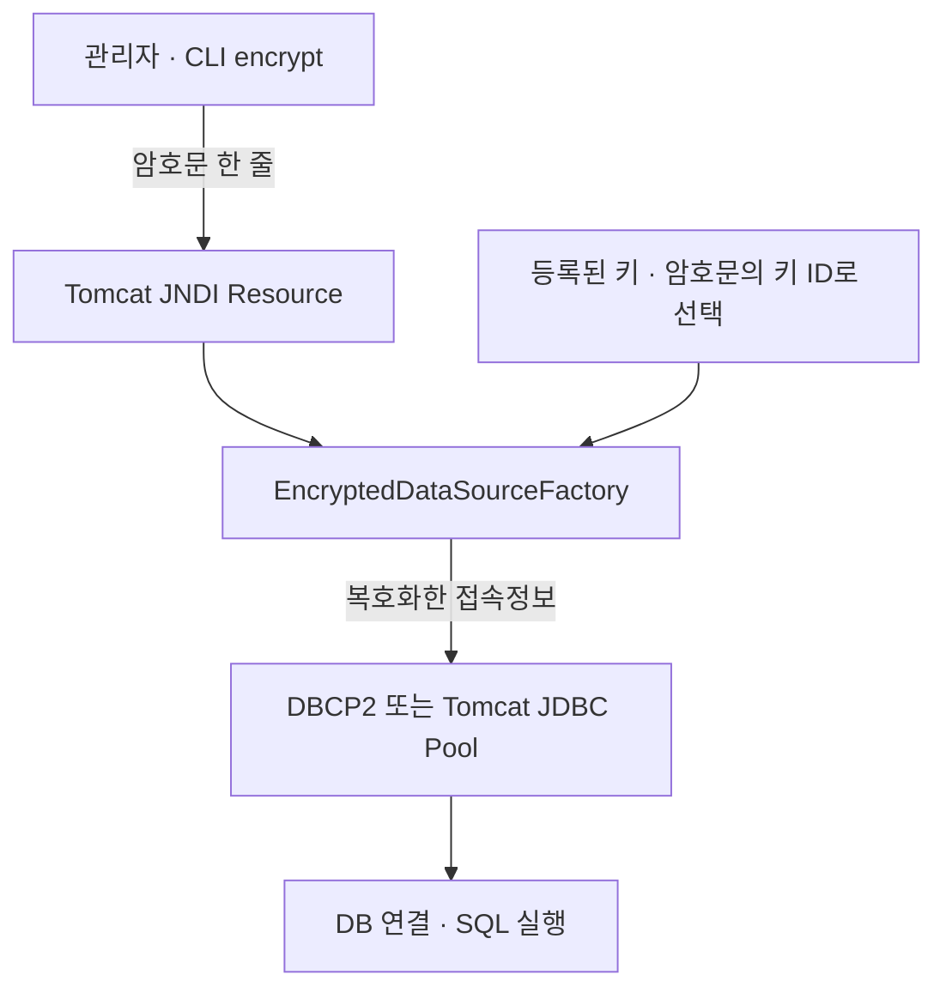

# Tomcat JDBC 접속정보 암호화 연동

[프로젝트 소개](../../README.md) · [전체 가이드](../user-guide.md)

Tomcat의 JNDI DataSource에 설정된 DB 계정·비밀번호를 보호합니다. 기존 애플리케이션의 JNDI 조회 코드는 유지하고, CLI로 준비한 암호문을 Factory가 복호화하여 실제 Connection Pool에 넘깁니다.

<a name="guide-contents"></a>
**이 문서에서 찾을 수 있는 내용**

[어떤 키 방식으로 연동할까요?](#tomcat-key-choice) · [적용 흐름: DB 비밀번호를 암호화해서 연결하기](#guide-section-2) · [적용 절차 및 Resource 설정](#topic-tomcat) · [운영 변경 및 장애 대응](#tomcat-operation) · [Connection Pool 옵션](#topic-connection-pools)

---

<a name="tomcat-key-choice"></a>
## 어떤 키 방식으로 연동할까요?

JCK Factory는 암호문의 키 ID로 관리형 키를 찾아 AES-256-GCM 복호화 후 기존 Connection Pool에 접속정보를 전달합니다. `pass` 또는 `key`는 암호화 키를 만드는 방법이며 Pool 종류, DB 계정 인증 방식과는 관계없습니다. DB 로그인 비밀번호 자체를 암호화 키로 재사용하지 않습니다.

| 선택 | `pass` | `key` |
|---|---|---|
| 키 재료 | 사용자가 정한 비밀 문자열 또는 JCK가 생성한 Passphrase | 정확히 32바이트인 AES 키 |
| 준비 방식 | PBKDF2-HMAC-SHA256, 키별 16바이트 Salt, 기본 600,000회 | 보안 난수 키 생성 또는 기존 AES 키 사용 |
| 암호화 방식 | AES-256-GCM | AES-256-GCM |
| 언제 선택 | Passphrase 기반 관리가 필요한 환경 | 새 시스템에서 무작위 키를 관리하거나 기존 AES 키가 있는 환경 |
| CLI 선택 | `encrypt --type pass` 또는 해당 `--key-id` | `encrypt --type key` 또는 해당 `--key-id` |
| 운영 보관 | 동일 키 복원에 필요한 백업(원래 Passphrase·Salt·KDF 정보) 또는 같은 키의 JAR | 동일 AES 키·키 ID 또는 같은 키의 JAR |

**JCK가 기본 제공하는 것:** 공개 JAR의 `pass-default`(기본 유형)와 `default`(key 유형)는 설치 없이 시험하는 공개 예제 키입니다. 암호화 동작을 확인할 수 있지만 실제 DB 비밀번호에는 쓰지 않습니다. 사용자 지정 키를 추가하거나 내장하면 새 JAR를 만들 수 있습니다. 같은 Passphrase로 신규 등록하더라도 Salt가 새로 생성되면 기존 암호문을 풀 수 없습니다.

### 키를 어디에 둘까요?

| 공급원 | Tomcat에서 쓰는 방법과 특징 |
|---|---|
| `embedded` | 키가 들어 있는 사용자 지정 JAR를 CLI와 Tomcat에 함께 사용. 배포는 간단하지만 JAR에서 키 추출이 가능하므로 JAR 접근 통제 필수 |
| `file` | JAR와 별개로 보호된 파일을 서비스 계정이 읽음. pass는 Passphrase, key는 표준 Base64 AES 키 |
| `env` | 서비스 프로세스에 비밀 환경변수를 제공. CLI와 Tomcat 모두 같은 키 재료를 읽어야 함 |
| `vault` | 기존 Vault KV v2에서 키 재료 조회. 권한·TLS·경로·버전 및 가용성 확인 |
| `aws-kms` | KMS로 보호한 데이터 키 파일과 선택 SDK 사용. IAM·KMS 접근 필요. JCK가 데이터 암복호화에 사용하는 키를 복원하는 방식 |

`pass/key`와 공급원은 다른 선택 축입니다. JAR 배포의 간편함이 우선이라면 사용자 지정 내장 키, 키와 JAR의 분리가 필요하면 파일·환경변수, 기존 외부 키 관리 체계가 있으면 Vault·KMS를 검토합니다. [공급원별 상세 설정](key-management.md#topic-key-management) · [Vault/KMS 설정 예제](external-key-providers.md).

**세 가지 비밀은 별개입니다.** CLI 관리자 비밀번호는 민감 명령의 접근 확인, 암호화 키는 DB 접속정보 암복호화, DB 비밀번호는 DB 로그인에 사용됩니다. Tomcat 기동 시 CLI 관리자 비밀번호나 Passphrase를 수동 입력하지 않습니다. 필요한 키는 JAR 또는 설정에서 읽습니다.

<a name="guide-section-2"></a>
## 적용 흐름: DB 비밀번호를 암호화해서 연결하기

| 단계 | 수행 작업 | 확인할 결과 |
|---|---|---|
| 1 | JCK JAR와 DB JDBC 드라이버 준비 | 사용할 Tomcat과 Pool 선택 |
| 2 | CLI 관리자 비밀번호 설정, 업무용 키 준비 | 새 설정 JAR 또는 외부 키 설정 확보 |
| 3 | 같은 키로 CLI `encrypt` 실행 | 암호문 전체를 복사 (`ENC[...]`) |
| 4 | JCK JAR와 JDBC 드라이버를 Tomcat `lib`에 배치 | 암호화에 쓴 키를 Tomcat 서비스 계정에서 읽을 수 있어야 함 |
| 5 | JNDI Resource의 Factory·password 및 Pool 속성 설정 | 기존 JNDI 이름 유지 |
| 6 | Tomcat 재시작, JNDI 조회 후 실제 SQL 실행 | DB 연결 성공 |



### 방법 A. Passphrase(`pass`)로 키와 암호문 준비

아래는 **새 환경에서 업무용 Passphrase 키를 내장하는 예**입니다. 이미 운영 키를 쓰고 있다면 키를 다시 생성하지 말고 같은 JAR·외부 설정으로 `encrypt`만 실행합니다.

```bash
java -jar java-crypto-kit-0.1.0.jar admin setup --operator example-admin
java -jar java-crypto-kit-0.1.0-configured.jar config key add --key-id app-pass --active --operator example-admin --reason "Tomcat DB 접속정보 보호" --out app-tomcat.jar
java -jar app-tomcat.jar doctor
java -jar app-tomcat.jar encrypt --key-id app-pass
java -jar app-tomcat.jar verify
```

실제 터미널에서 관리자 비밀번호와 Passphrase를 화면에 보이지 않게 입력하고, 키 변경 확인에 응답합니다. `doctor`의 결과와 키 상태를 확인한 뒤 암호문 한 줄 전체를 Resource에 붙입니다. `app-tomcat.jar`를 반드시 안전하게 백업합니다. 내장 pass 키의 Passphrase 원문은 JAR에서 복원할 수 없습니다. 같은 문자열로 새 키를 등록해도 새 Salt로 다른 키가 생성됩니다. 원래 JAR를 유지하거나, 최초 생성 시 `--generate --export <백업파일>`을 사용해 복원 정보를 별도로 보관하는 방법을 선택하세요([키 복구 절차](key-management.md#topic-key-recovery)). 아래 기존 상세 예제의 `java-crypto-kit-0.1.0-configured-2.jar`는 같은 역할의 사용자 지정 키 JAR 이름입니다. 실제 파일명으로 바꾸어 실행하세요. Tomcat은 이 CLI 관리자 비밀번호를 묻지 않습니다.

### 방법 B. 무작위 AES 키(`key`)로 준비하기

Passphrase 방식 대신 JCK가 32바이트 AES 키를 직접 생성하게 할 수 있습니다. 아래 명령은 위와 **별개의 대안**입니다. 최초 관리자 설정은 한 번만 실행하며 이미 설정한 JAR에서 시작합니다. `--export` 경로는 접근 제한된 기존 디렉터리의 새 파일이어야 합니다.

```bash
java -jar java-crypto-kit-0.1.0-configured.jar config key add --key-id app-aes --type key --generate --export /secure/app-aes.key --active --operator example-admin --reason "Tomcat AES key" --out app-tomcat-aes.jar
java -jar app-tomcat-aes.jar doctor
java -jar app-tomcat-aes.jar encrypt --key-id app-aes
java -jar app-tomcat-aes.jar verify
```

Windows에서는 `/secure/app-aes.key`를 접근 제한된 실제 Windows 경로로 바꿉니다. 관리자 인증 및 `CHANGE` 확인에 응답합니다. `encrypt`에서 입력하는 것은 DB 비밀번호이며 `verify`에는 출력된 암호문 전체를 입력합니다. `verify` 성공은 암호문 확인이지 DB 연결 확인이 아닙니다.

이미 AES 키 파일이 있다면 `--generate --export ...` 대신 `--from-file /secure/existing.key`를 사용합니다. 키 파일은 정확히 32바이트를 표준 Base64로 나타낸 값입니다. `keygen` 후 `config embed-key` 방식도 가능합니다([키 생성·내장](key-management.md#topic-key-generation)).

### 결과 JAR와 암호문을 맞추기

| 사용할 설정 | Resource에 넣는 값 | Tomcat에 배포 |
|---|---|---|
| 사용자 지정 pass | `encrypt --key-id app-pass`의 전체 출력 | `app-tomcat.jar` |
| 사용자 지정 key | `encrypt --key-id app-aes`의 전체 출력 | `app-tomcat-aes.jar` |
| 외부 공급원 | 동일 외부 설정으로 실행한 `encrypt` 출력 | 키 정의 및 공급원 설정을 읽을 수 있는 JAR·외부 파일·서비스 환경 |

`--active`는 해당 **유형의** 기본 키를 바꿉니다. 기본 유형 자체가 `pass`라면 `key`를 추가한 뒤 단순 `encrypt`를 실행할 경우 기존 pass 키로 암호화될 수 있습니다. 따라서 위처럼 키 ID를 명시하고 출력의 키 ID가 의도한 값인지 확인합니다. 복호화 Factory는 키 ID로 키를 선택하므로 Resource에 `pass/key` 옵션을 따로 적지 않습니다. 이후 아래 공통 JNDI 설정을 수행합니다.

- 이미 보유한 AES 키, 외부 키, 키 복구: [키 관리](key-management.md) / [외부 키 공급원](external-key-providers.md)
- 명령별 상세 옵션과 Windows·Linux 예제: [CLI 문자열 암복호화](cli.md#topic-cli-encryption)
- DB 비밀번호만 바뀐 경우: 같은 키로 다시 `encrypt`하고 Resource를 변경합니다. 키 재생성은 필요 없습니다.

<a name="topic-tomcat"></a>

## 적용 절차 및 Resource 설정

<a name="topic-tomcat--tomcat-datasource-연동"></a>
<a name="topic-tomcat--3-tomcat-jndi-연동"></a>
<a name="topic-tomcat--3-tomcat"></a>
<a name="topic-tomcat--첫-실행-예제"></a>
### 첫 실행 예제

1. 사용자 지정 키를 설정한 JAR와 JDBC 드라이버를 `CATALINA_BASE/lib`에 배치합니다.
2. 같은 키로 DB 비밀번호를 암호화합니다.
3. JNDI `Resource`의 `factory`와 `password`를 변경하고 `cryptoPool`로 Pool을 선택합니다. 계정도 암호화할 수 있습니다.
4. 재시작 후 JNDI 조회·DB 연결·SQL을 확인합니다.

아래 [Pool 선택표](#topic-tomcat--32-dbcp2와-tomcat-jdbc-pool-선택)에서 Resource에 넣을 값을 확인하세요.

<a name="topic-tomcat--31-적용-순서"></a>
### 적용 순서 (3.1)

1. **운영 키 준비:** 공개 예제 키 대신 사용자 지정 키를 씁니다([1.3절](key-management.md#topic-key-selection--13-체험용-내장-키와-운영용-사용자-지정-키)).
2. **설치:** 키 내장 JAR(또는 외부 키를 쓰는 공개 JAR)와 DB의 JDBC 드라이버 JAR를 `CATALINA_BASE/lib`에 복사합니다. 같은 `lib`에는 java-crypto-kit JAR를 **하나만** 둡니다(웹앱 `WEB-INF/lib`에도 둘 때의 동작은 [3.7절](#topic-tomcat--37-jar를-lib과-웹앱에-함께-둘-때)).
3. **암호화:** Tomcat과 같은 JAR·설정으로 `encrypt`를 실행해 DB 비밀번호 암호문을 만듭니다. pass·key 어느 유형의 암호문이든 쓸 수 있습니다(Factory가 암호문의 키 ID로 키를 고름).
4. **Resource 작성:** 실제 Context 파일에 `factory`, `cryptoPool`과 암호문 `password`를 넣은 `<Resource>`를 둡니다([3.3절](#topic-tomcat--33-resource를-넣을-파일)·[3.4절](#topic-tomcat--34-resource-주요-속성)).
5. **재시작과 확인:** Tomcat을 재시작한 뒤 애플리케이션에서 JNDI 조회·`getConnection()`·실제 SQL을 확인합니다([3.5절](#topic-tomcat--35-애플리케이션의-조회-코드)).

Tomcat Factory는 CLI 관리자 비밀번호를 읽거나 묻지 않습니다. 관리자 비밀번호를 설정한 JAR·설정하지 않은 JAR·검증값이 손상된 JAR 모두 Tomcat 기동과 복호화는 같게 동작합니다(관리자 비밀번호는 CLI 전용, [1.4절](cli.md#topic-admin--14-cli-관리자-비밀번호)).

```powershell
Copy-Item .\java-crypto-kit-0.1.0-configured-2.jar C:/tomcat/lib/
```

```bash
cp ./java-crypto-kit-0.1.0-configured-2.jar /opt/tomcat/lib/ && chown tomcat:tomcat /opt/tomcat/lib/java-crypto-kit-0.1.0-configured-2.jar
```

<a name="topic-tomcat--32-dbcp2와-tomcat-jdbc-pool-선택"></a>
### DBCP2와 Tomcat JDBC Pool 선택 (3.2)

| 판단 기준 | DBCP2 | Tomcat JDBC Pool |
|---|---|---|
| 언제 선택 | **신규·일반 DB 연결(기본값)** | 이미 Tomcat JDBC Pool을 쓰거나 `jdbcInterceptors` 등 전용 기능이 필요할 때 |
| Pool JAR | `tomcat-dbcp.jar`(Tomcat에 포함) | `tomcat-jdbc.jar`(없으면 Tomcat 버전에 맞게 추가) |
| XML Resource 속성 | `cryptoPool="dbcp2"` | `cryptoPool="tomcat-jdbc"` |
| 최대 연결 | `maxTotal` | `maxActive` |
| 최대 대기(ms) | `maxWaitMillis` | `maxWait` |
| 예제 | [dbcp2-context.xml](../tomcat/dbcp2-context.xml) | [jdbc-pool-context.xml](../tomcat/jdbc-pool-context.xml) |

두 예제의 `factory`는 같은 복호화 Factory입니다.

**선택 우선순위:** Resource의 `cryptoPool` > 유효한 공통 `crypto.pool.factory` > 배포 JAR 기본값 DBCP2. XML에서 생략한 Resource만 공통 설정을 따릅니다. 같은 Context, JVM, JCK JAR에서 Resource마다 두 Pool을 섞어 쓸 수 있습니다.

`cryptoPool`은 정확한 소문자 `dbcp2` 또는 `tomcat-jdbc`를 한 번만 받습니다. 빈 값·공백·대소문자 차이·클래스명·중복 설정은 복호화 전에 `CONFIGURATION`으로 거부합니다. Properties와 JVM 옵션에 쓰는 키는 기존 `crypto.pool.factory`입니다. 공통 설정 자체가 잘못된 경우 XML 값을 지정해도 오류입니다.

Pool 속성 이름은 Pool마다 다르므로 섞어 쓰지 않습니다.

**최소 Resource 예제**

```xml
<Resource name="jdbc/myDB" auth="Container" type="javax.sql.DataSource"
          factory="io.javacryptokit.jdbc.tomcat.EncryptedDataSourceFactory"
          cryptoPool="dbcp2"
          driverClassName="org.mariadb.jdbc.Driver"
          url="jdbc:mariadb://db.example.com:3306/mydb"
          username="app_user" password="ENC[v1:...실제 encrypt 출력...]"
          maxTotal="20" validationQuery="SELECT 1" testOnBorrow="true" />
```

<a name="pool-configuration-examples"></a>
### DBCP2·Tomcat JDBC Pool 전체 설정 예제

필요한 Pool의 `<Resource>`를 기존 `<Context>` 안에 추가합니다. 둘 다 쓰려면 아래 혼용 예처럼 서로 다른 JNDI 이름을 사용하세요. MariaDB 예시이므로 드라이버 클래스·URL·계정·검증 SQL을 실제 DB에 맞춥니다. `password` 예시는 유효한 암호문이 아니므로 위 `encrypt` 실행 결과로 **전체를 교체**하세요.

#### DBCP2 (기본 Pool)

`cryptoPool="dbcp2"`를 지정합니다. Tomcat의 `tomcat-dbcp.jar`를 사용하며, JNDI 이름과 Pool 한도를 기존 환경에 맞춰 설정합니다.

```xml
<Context>
  <Resource name="jdbc/myDB"
            auth="Container"
            type="javax.sql.DataSource"
            factory="io.javacryptokit.jdbc.tomcat.EncryptedDataSourceFactory"
            cryptoPool="dbcp2"
            driverClassName="org.mariadb.jdbc.Driver"
            url="jdbc:mariadb://db.example.com:3306/mydb"
            username="app_user"
            password="ENC[v1:key01:REPLACE_IV:REPLACE_CIPHERTEXT]"
            initialSize="1"
            maxTotal="20"
            minIdle="1"
            maxIdle="10"
            maxWaitMillis="5000"
            validationQuery="SELECT 1"
            validationQueryTimeout="3"
            testOnBorrow="true"
            testWhileIdle="true"
            timeBetweenEvictionRunsMillis="30000" />
  <!-- 추가 선택(기본 비활성): 누수 회수는 정상적인 장기 트랜잭션도 끊을 수 있으므로
       removeAbandonedOnBorrow / removeAbandonedOnMaintenance / removeAbandonedTimeout 등은
       장애 원인과 최대 트랜잭션 시간을 확인한 뒤 Resource 속성에 직접 추가한다. -->
</Context>
```

#### Tomcat JDBC Pool

Tomcat JDBC Pool을 쓰려면 `tomcat-jdbc.jar`를 준비하고 같은 Resource에 `cryptoPool="tomcat-jdbc"`를 지정합니다. 공통 기본값을 운영하는 경우는 [설정 사전](../reference/configuration.md#102-동작과-tomcat-정책)을 참고하세요.

```xml
<Context>
  <Resource name="jdbc/myDB"
            auth="Container"
            type="javax.sql.DataSource"
            factory="io.javacryptokit.jdbc.tomcat.EncryptedDataSourceFactory"
            cryptoPool="tomcat-jdbc"
            driverClassName="org.mariadb.jdbc.Driver"
            url="jdbc:mariadb://db.example.com:3306/mydb"
            username="app_user"
            password="ENC[v1:key01:REPLACE_IV:REPLACE_CIPHERTEXT]"
            initialSize="1"
            maxActive="20"
            minIdle="1"
            maxIdle="10"
            maxWait="5000"
            validationQuery="SELECT 1"
            validationQueryTimeout="3"
            testOnBorrow="true"
            testWhileIdle="true"
            timeBetweenEvictionRunsMillis="30000" />
  <!-- 추가 선택(기본 비활성): validationInterval, jdbcInterceptors, removeAbandoned,
       removeAbandonedTimeout, logAbandoned 등은 Tomcat JDBC Pool 전용이다. 연결 누수 회수와
       인터셉터는 성능·트랜잭션에 영향이 있으므로 운영 기준에 따라 별도로 설정한다. -->
</Context>
```

#### 같은 Context에서 두 Pool 사용

JNDI 이름별로 Pool을 고릅니다. 아래에서 DBCP2에 pass 키, Tomcat JDBC Pool에 key 키로 만든 암호문을 넣는 것은 예시입니다. 두 유형은 어느 Pool에서도 사용할 수 있습니다.

```xml
<Context>
  <Resource name="jdbc/DBCP2"
            auth="Container"
            type="javax.sql.DataSource"
            factory="io.javacryptokit.jdbc.tomcat.EncryptedDataSourceFactory"
            cryptoPool="dbcp2"
            driverClassName="org.mariadb.jdbc.Driver"
            url="jdbc:mariadb://db.example.com:3306/mydb"
            username="app_user"
            password="ENC[v1:key01:REPLACE_IV:REPLACE_CIPHERTEXT]"
            initialSize="1"
            maxTotal="20"
            minIdle="1"
            maxIdle="10"
            maxWaitMillis="5000"
            validationQuery="SELECT 1"
            validationQueryTimeout="3"
            testOnBorrow="true"
            testWhileIdle="true"
            timeBetweenEvictionRunsMillis="30000" />
  <Resource name="jdbc/TomcatJDBC"
            auth="Container"
            type="javax.sql.DataSource"
            factory="io.javacryptokit.jdbc.tomcat.EncryptedDataSourceFactory"
            cryptoPool="tomcat-jdbc"
            driverClassName="org.mariadb.jdbc.Driver"
            url="jdbc:mariadb://db.example.com:3306/mydb"
            username="app_user"
            password="ENC[v1:key01:REPLACE_IV:REPLACE_CIPHERTEXT]"
            initialSize="1"
            maxActive="20"
            minIdle="1"
            maxIdle="10"
            maxWait="5000"
            validationQuery="SELECT 1"
            validationQueryTimeout="3"
            testOnBorrow="true"
            testWhileIdle="true"
            timeBetweenEvictionRunsMillis="30000" />
</Context>
```

`maxTotal`·`maxWaitMillis`(DBCP2)와 `maxActive`·`maxWait`(Tomcat JDBC Pool)는 서로 바꿔 쓰지 않습니다. Pool의 모든 속성과 선택 기준은 [같은 문서의 Pool 옵션](#topic-connection-pools)에서 확인합니다.

<a name="topic-tomcat--33-resource를-넣을-파일"></a>
### Resource를 넣을 파일 (3.3)

| 위치(Tomcat이 실제로 읽는 파일) | 적용 범위 | 언제 쓰나 |
|---|---|---|
| `<웹앱>/META-INF/context.xml` | 그 웹앱 | 웹앱별 Resource를 배포본과 함께 관리(일반적) |
| `CATALINA_BASE/conf/Catalina/localhost/<앱>.xml` | 지정한 앱 | WAS 운영자가 Context를 배포본과 분리해 관리 |
| `CATALINA_BASE/conf/context.xml` | 모든 웹앱의 기본 Context | 공통 설정이 꼭 필요할 때만. 웹앱마다 Pool이 따로 생기고 모든 앱에 비밀번호가 적용되므로 주의 |
| `conf/server.xml`의 `GlobalNamingResources` + 앱의 `ResourceLink` | 전역 정의 후 앱별 연결 | 여러 앱이 Resource 하나를 명시적으로 함께 쓰도록 설계했을 때 |

**예제 파일 이름은 설명용입니다.** 저장소의 `docs/tomcat/dbcp2-context.xml`·`jdbc-pool-context.xml`을 그 이름 그대로 두어도 Tomcat은 읽지 않습니다.

이미 있는 Context 파일이면 `<Context>` 안에 `<Resource ... />` 하나만 붙여 넣습니다(파일 전체를 바꾸지 않음).

**전역 Resource를 사용할 때의 연결 구조**

`server.xml`의 기존 `<GlobalNamingResources>` 안에 Resource를 추가하고, 사용하는 앱의 `<Context>` 안에 ResourceLink를 둡니다. 두 이름은 일치하도록 지정합니다. 동일한 XML 파일 전체를 덮어쓰지 않습니다.

```xml
<!-- conf/server.xml: 기존 GlobalNamingResources 내부에 추가 -->
<Resource name="jdbc/myDB" auth="Container" type="javax.sql.DataSource"
          factory="io.javacryptokit.jdbc.tomcat.EncryptedDataSourceFactory"
          cryptoPool="dbcp2"
          driverClassName="org.mariadb.jdbc.Driver"
          url="jdbc:mariadb://db.example.com:3306/mydb"
          username="app_user" password="ENC[v1:실제-암호문]" />
```

```xml
<!-- 앱의 META-INF/context.xml 또는 앱별 Context 내부 -->
<ResourceLink name="jdbc/myDB" global="jdbc/myDB" type="javax.sql.DataSource" />
```

`password`의 자리표시자는 반드시 실제 `encrypt` 결과 전체로 바꿉니다. 계정도 암호화하려면 별도로 `encrypt`를 실행하고 결과를 `username`에 넣습니다. 기존 애플리케이션은 그대로 `java:comp/env/jdbc/myDB`를 조회합니다.

`NameNotFoundException`이면 먼저 ResourceLink의 이름과 전역 Resource 이름, XML의 위치를 확인합니다.

<a name="topic-tomcat--34-resource-주요-속성"></a>
### Resource 주요 속성 (3.4)

| 속성 | 기본·예제 값 | 선택 판단 |
|---|---|---|
| `name` | `jdbc/myDB` | 앱에서 `java:comp/env/jdbc/myDB`로 조회할 이름 |
| `auth` | **`Container`(일반)** / `Application` | 리소스 인증 책임 선언. 앱이 리소스 관리자에 직접 인증하는 별도 설계가 아니면 `Container` |
| `type` | `javax.sql.DataSource` | 이 Factory가 지원하는 타입(Tomcat 10.1·11에서도 `javax.sql`) |
| `factory` | `io.javacryptokit.jdbc.tomcat.EncryptedDataSourceFactory` | **항상 이 복호화 Factory**를 써야 ENC/B64 비밀번호를 처리 |
| `cryptoPool` | `dbcp2` / `tomcat-jdbc` | 이 Resource의 공식 Pool. 생략하면 공통 `crypto.pool.factory` 사용 |
| `driverClassName` | `org.mariadb.jdbc.Driver` | 실제 DB 드라이버 클래스 |
| `url` | `jdbc:mariadb://...` | 대상 DB의 실제 JDBC URL |
| `username` | 평문 계정 또는 `ENC[...]` | 계정 암호화는 선택 |
| `password` | 사용자 지정 키로 만든 `ENC[...]`/`B64[...]` | 평문은 거부. 암호문의 키 ID가 Tomcat에 배포한 JAR(또는 설정)의 키 목록에 있고 같은 키여야 함(유형 속성은 따로 없음) |

`auth="Container"`는 Tomcat이 리소스 관리자에 로그인할 책임을 갖는 일반적인 선언이고, `auth="Application"`은 웹앱 코드가 인증 책임을 갖는다는 선언입니다.

이 값만 바꿔 다른 DB 계정으로 자동 접속되지는 않으며, `getConnection(user, password)` 같은 방식은 Pool의 지원 여부와 업무 코드 설계를 함께 판단해야 합니다.

공식 값과 범위는 [Tomcat Context의 Resource 정의](https://tomcat.apache.org/tomcat-11.0-doc/config/context.html)를 참고합니다.

**선택형 JNDI 속성**은 보통 생략하고 기본값을 유지합니다.

| 속성 | 허용값·기본 | 언제 바꾸나 |
|---|---|---|
| `scope` | `Shareable`(기본) / `Unshareable` | 연결 공유를 제한하는 특수 설계에서만. 일반 DB Pool은 기본 유지 |
| `singleton` | `true`(기본) / `false` | JNDI 조회마다 새 객체가 필요할 때만 `false`. DataSource JMX 등록에는 `true` 필요 |
| `description` | 설명 문자열(선택) | 운영자가 Resource 용도를 구분할 때 |
| `closeMethod` | 인자 없는 메서드 이름, `""`이면 비활성 | 특별한 종료 정책이 필요할 때만. 일반 DataSource는 기본 `close` 유지 |

그 밖의 Pool 속성은 [4장](#topic-connection-pools--4-connection-pool-설정)을 봅니다.

<a name="topic-tomcat--35-애플리케이션의-조회-코드"></a>
### 애플리케이션의 조회 코드 (3.5)

기존에 JNDI DataSource를 쓰는 애플리케이션이라면 **업무 코드를 바꿀 필요가 없습니다.** 아래는 연결 확인용 예제이며 `SELECT 1`은 MariaDB 기준입니다.

```java
javax.naming.Context context = new javax.naming.InitialContext();
javax.sql.DataSource ds = (javax.sql.DataSource) context.lookup("java:comp/env/jdbc/myDB");
try (java.sql.Connection conn = ds.getConnection();
     java.sql.PreparedStatement ps = conn.prepareStatement("SELECT 1");
     java.sql.ResultSet rs = ps.executeQuery()) {
    if (!rs.next() || rs.getInt(1) != 1) throw new IllegalStateException("DB connection check failed");
}
```

웹앱 안에서 이 코드가 예외 없이 끝나면 JNDI 조회, 실제 연결 대여, SQL 결과 `1`까지 확인한 것입니다. `verify`는 성공하고 여기에서 실패하면 JNDI 이름, Pool·드라이버 배치, DB 로그인 권한을 순서대로 확인합니다.

<a name="topic-tomcat--36-jvm-공통-범위와-재시작"></a>
### JVM 공통 범위와 재시작 (3.6)

- **Tomcat의 공용 `lib`에서 JCK 하나를 쓰는 배치에서는 같은 키 목록과 공통 설정을 사용합니다.** Resource마다 다른 키를 쓰려면 그 키들을 모두 같은 JAR의 키 목록에 등록하고 Resource마다 해당 키로 만든 암호문을 넣습니다(암호문의 키 ID로 자동 선택). Pool은 각 Resource의 `cryptoPool`로 정하고, 생략한 Resource는 공통 기본값을 따릅니다.

  여러 서버에는 같은 키 내장 JAR를 배포하고 `fingerprint`로 같은 키인지 확인합니다.
- **설정과 키는 DataSource를 만들 때 읽습니다**(실행 중 자동 반영 없음). 설정·키·암호문을 바꾸면 Tomcat을 재시작합니다. `initialSize`가 0보다 크면 기동할 때 첫 연결을 만들므로 비밀번호 오류가 바로 로그에 나타납니다.
- **외부 설정을 쓰는 경우(콘솔·스크립트로 실행):** Linux는 `bin/setenv.sh`에 `CATALINA_OPTS="$CATALINA_OPTS -Dcrypto.config.file=/etc/java-crypto-kit/app.properties"`, Windows를 `startup.bat`·`catalina.bat`으로 실행할 때는 `bin/setenv.bat`에 `set "CATALINA_OPTS=%CATALINA_OPTS% -Dcrypto.config.file=C:/secure/app.properties"`를 둡니다.
- **Windows 서비스로 실행하는 경우:** 서비스는 `setenv.bat`을 읽지 않습니다.

  Tomcat 서비스 설정 도구(예: `tomcat9w.exe`의 Java 탭 Java Options)에 `-Dcrypto.config.file=C:/secure/app.properties`를 한 줄로 추가하거나, 명령으로 `tomcat9.exe //US//Tomcat9 ++JvmOptions=-Dcrypto.config.file=C:/secure/app.properties`처럼 바꾼 뒤 서비스를 재시작합니다(실행 파일·서비스 이름은 설치한 Tomcat에 맞게). Windows 서비스 실행은 실서버에서 검증하지 않았습니다.
- **키 환경변수**(`crypto.key.source=env`)는 Tomcat을 실행하는 계정·서비스에 전달되어야 합니다(Linux systemd `Environment=`, Windows 서비스의 환경 설정). CLI를 실행한 계정의 환경변수와 다를 수 있습니다.
- **로그의 비밀값 정제 범위:** Factory는 DataSource를 만드는 동안의 오류에서 비밀번호·키·암호문을 지우고 원인 유형만 남깁니다. 그 뒤 `getConnection()` 단계에서 Pool·JDBC 드라이버가 직접 내는 예외·로그는 이 라이브러리 범위 밖입니다.

<a name="topic-tomcat--37-jar를-lib과-웹앱에-함께-둘-때"></a>
### JAR를 lib과 웹앱에 함께 둘 때 (3.7)

권장 배치는 Tomcat `lib`에 JAR **하나**입니다. Tomcat `lib`(JAR A)와 웹앱 `WEB-INF/lib`(JAR B)에 서로 다른 키 내장 JAR를 함께 두면, Tomcat은 두 JAR를 **서로 다른 클래스로더의 별개 사본**으로 다룹니다.

아래는 Docker의 실제 Tomcat 9.0(Java 8)·11.0(Java 21), DBCP2·Tomcat JDBC Pool, MariaDB에서 확인한 동작입니다(실운영 서버 검증 아님).

| Resource를 정의한 곳 | 그 Resource를 만드는 JAR(Factory) | 확인한 결과 |
|---|---|---|
| `conf/server.xml`의 `GlobalNamingResources`(+ 앱의 `ResourceLink`) | Tomcat 기동 시 `lib`의 JAR A | JAR A의 키·Pool 설정으로 연결 |
| `<웹앱>/META-INF/context.xml` | 그 웹앱의 클래스로더가 찾은 JAR: `WEB-INF/lib`에 있으면 JAR B, 없으면 `lib`의 JAR A | JAR B가 있는 앱에 JAR A의 키로 만든 암호문을 넣으면 `KEY_ID_MISMATCH` |
| `conf/context.xml`(모든 웹앱의 기본 Context) | 위와 같은 규칙으로 **웹앱마다** 따로 정해짐 | 같은 Resource 정의라도 JAR B가 있는 앱은 JAR B, 없는 앱은 JAR A가 처리 |
| 웹앱 코드의 Java API(`CredentialCrypto`) | 그 웹앱 `WEB-INF/lib`의 JAR B | JAR B의 키 목록·기본 키만 보임(JAR A와 다른 클래스). 문자열·파일 암복호화 모두 JAR B의 키로 하며, JAR A가 만든 암호문·암호화 파일은 `KEY_ID_MISMATCH`로 거부 |

- **키·설정·지문은 사본마다 따로입니다.** 각 JAR는 자기 내장 설정(키 목록·기본 키·생략 시의 `crypto.pool.factory`)을 읽습니다. 다른 JAR의 키로 만든 암호문은 `KEY_ID_MISMATCH`로 거부되어 교차 복호화되지 않습니다. JAR마다 키 ID를 다르게 만들어 두면 어느 JAR가 처리했는지 오류만으로도 구분됩니다.
- **JVM 전체 설정은 두 JAR에 모두 적용됩니다.** `CATALINA_OPTS`의 `-Dcrypto.*`, `-Dcrypto.config.file`, 환경변수 `CRYPTO_CONFIG_FILE`은 사본을 가리지 않습니다.

  예를 들어 JAR A에만 있는 키 ID를 `-Dcrypto.key.active.pass`로 주면 JAR B는 `CONFIGURATION`으로 실패합니다. 외부 설정이 `crypto.key.*`(AES 키 슬롯)를 바꾸면 두 JAR가 같은 AES 키를 쓰게 되어 그 키의 암호문은 서로 복호화됩니다.

  이때 각 JAR의 원래 AES 키는 빠지고, 키 목록의 pass 키는 각자 그대로입니다. JAR마다 다른 값은 JVM 설정이 아니라 각 JAR의 내장 설정(`config set`·`config key`)에 둡니다.
- **JVM 공통 `-D`를 한쪽 JAR에서 막기:** JAR B에 `crypto.jvm.override.enabled=false`를 넣으면(`java -jar <JAR B> config set crypto.jvm.override.enabled=false --operator <ID> --reason <사유>`) 같은 JVM의 `-Dcrypto.*` 값을 JAR B는 무시하고 자기 내장 설정대로 동작합니다(위 `-Dcrypto.key.active.pass` 예에서 JAR B는 실패하지 않고 자기 기본 키를 씀, JAR A는 그 값을 따름). 이 정책은 `-D` 설정 값만 막으며, 외부 설정 파일 지정(`-Dcrypto.config.file`, 환경변수 `CRYPTO_CONFIG_FILE`)은 그대로 적용되므로 JVM 전체에 외부 설정 파일을 걸지 않습니다.

  무시된 `-D`는 `info`·`doctor`에 표시됩니다.
- **공개 기본 키 경고는 사본마다 1회**입니다. 두 사본이 모두 공개 키를 쓰면 경고가 2건 남습니다.
- **웹앱 안의 JAR B는 그 웹앱 코드와 같은 신뢰 범위**입니다. 그 웹앱의 코드는 JAR B에 등록된 키로 복호화할 수 있으므로, 웹앱 코드에 맡기지 않을 키는 JAR B에 넣지 않습니다.
- **클래스로더 분리는 기능적 분리이지 보안 격리가 아닙니다.** 위 결과는 "각 사본이 자기 설정·키로 동작하고 서로의 암호문을 풀지 않는다"는 뜻일 뿐입니다.

  Tomcat `lib`의 JAR A는 공통 클래스로더에 있으므로 **같은 JVM의 모든 웹앱 코드**가 JAR A의 공개 API(`CredentialCrypto`)를 불러 JAR A의 키로 복호화할 수 있고(JAR B가 있는 웹앱도 부모 클래스로더로 접근 가능), JAR 파일을 읽을 수 있는 사람은 내장 키를 꺼낼 수 있습니다.

  CLI 관리자 비밀번호([1.4절](cli.md#topic-admin--14-cli-관리자-비밀번호))도 CLI 사용만 통제하며 이 경계를 바꾸지 않습니다. 신뢰할 수 없는 코드와 키를 나눠야 하면 JVM(프로세스)·서버·OS 계정을 분리합니다.
- 두 곳에 둘 이유가 없으면 `lib`에 하나만 둡니다. 두 곳에 둔다면 각 JAR로 `info`·`fingerprint`를 실행해 키 목록과 지문을 확인하고, 실제 JNDI 조회·SQL로 연결을 검증합니다.

<a name="tomcat-operation"></a>
## 운영 변경 및 장애 대응

| 상황 | 작업 순서 |
|---|---|
| DB 비밀번호만 변경 | 기존 운영 JAR로 `encrypt` → Resource의 암호문 변경 → 재시작·SQL 확인 |
| 암호화 키 교체 | [키 교체 절차](key-management.md#topic-key-rotation)로 새 키 등록·암호문 전환 → 키 포함 JAR 및 Resource 배포 → 연결 확인 후 이전 키 정리 |
| `KEY_ID_MISMATCH` / `INTEGRITY` | CLI `info`, `fingerprint`, `verify`로 암호문 키 ID와 실제 배포 키 일치 여부 확인 |
| `KEY_SOURCE` | Tomcat 서비스 계정의 외부 키 경로·권한·환경변수와 Vault/KMS 연결 확인 |
| `POOL_FAILURE` | DB 접속정보·JDBC URL·드라이버·Pool 설정 및 실제 SQLState 확인 |
| JNDI 조회 오류 | `name`, Context 위치, `ResourceLink` 이름과 앱 배포 경로 확인 |

`doctor`가 PASS여도 실제 DB 연결이 보장되지는 않습니다. 기존 DB 계정이 접속할 수 있는지와 연결 후 쿼리 성공 여부를 별도로 확인합니다. [전체 오류 코드와 조치](../reference/troubleshooting.md)

[이 문서의 목차로 ↑](#guide-contents)

<a name="topic-connection-pools"></a>

## Connection Pool 옵션

<a name="topic-connection-pools--connection-pool-설정"></a>
<a name="topic-connection-pools--4-connection-pool-설정"></a>
### Connection Pool 설정 (4)

**원칙:** java-crypto-kit은 일반 Resource 속성을 Tomcat 공식 Pool Factory에 그대로 넘깁니다. **넘긴다고 모든 속성이 적용된다는 뜻은 아닙니다.** 값·범위·지원 여부는 대상 Tomcat과 Pool 버전을 따릅니다.

<a name="topic-connection-pools--41-먼저-볼-기본-옵션"></a>
### 먼저 볼 기본 옵션 (4.1)

| 역할 | DBCP2 | Tomcat JDBC Pool | 판단 기준 |
|---|---|---|---|
| 최초 연결 | `initialSize` | 동일 | 기동 시 미리 여는 연결 수. 많으면 DB 세션 증가 |
| 최대 연결 | `maxTotal` | `maxActive` | DB 연결 한도와 WAS 노드 수에 맞춤 |
| 최소·최대 유휴 | `minIdle`, `maxIdle` | 동일 | 트래픽이 적을 때 유지할 연결 수 |
| 대기 시간(ms) | `maxWaitMillis` | `maxWait` | Pool이 가득 찼을 때 기다리는 한도 |
| 검사 SQL | `validationQuery` | 동일 | DBMS에 맞는 읽기 전용 SQL(MariaDB `SELECT 1`) |
| 검사 제한 시간(초) | `validationQueryTimeout` | 동일 | 검사 SQL이 오래 걸릴 때의 한도 |
| 빌려줄 때 검사 | `testOnBorrow` | 동일 | 오래된 연결 재사용 오류 방지. 검사 비용 고려 |
| 유휴 검사 | `testWhileIdle` | 동일 | 아래 검사 주기와 함께 설정 |
| 검사 주기(ms) | `timeBetweenEvictionRunsMillis` | 동일 | 검사 부하를 고려해 설정 |

예제의 `maxTotal=20`, `maxActive=20`, `maxWait=5000` 등은 **범용 최적값이 아닙니다.** DB 최대 세션, WAS 노드 수, 트래픽, 연결을 오래 쓰는 업무가 있는지 확인한 뒤 정합니다.

<a name="topic-connection-pools--42-문제가-생겼을-때-볼-고급-옵션"></a>
### 문제가 생겼을 때 볼 고급 옵션 (4.2)

| 증상 | DBCP2 | Tomcat JDBC Pool | 주의 |
|---|---|---|---|
| 연결 누수 | `removeAbandonedOnBorrow`, `removeAbandonedOnMaintenance` | `removeAbandoned` | 정상 장기 트랜잭션도 끊을 수 있음. 먼저 앱의 `close()` 확인 |
| 누수 판단 시간(초) | `removeAbandonedTimeout` | 동일 | 정상 최장 처리 시간 고려 |
| 진단 로그 | `logAbandoned` | 동일 | 로그량·스택 정보 주의 |
| 검사 빈도 | Pool 자체 정책 | `validationInterval`(ms) | Tomcat JDBC Pool 전용 |
| JDBC 인터셉터 | 해당 없음 | `jdbcInterceptors` | Tomcat JDBC Pool 전용 |
| 세션 초기화 SQL | `connectionInitSqls` 등 | `initSQL` | DBMS·Pool별 구문 확인 |

**증상별 우선 확인:** Pool 포화는 최대 연결·대기 시간, 유휴 후 연결 실패는 검사 SQL·빌려줄 때 검사, DB 세션 과다는 **노드 수 × Resource 수 × Pool 최대값**부터 봅니다.

DB 접속 성공만으로 Pool 옵션이 적용됐다고 판단하지 말고 Pool 지표·JMX·공식 설정 정보를 함께 확인합니다.

공식 문서: [Tomcat JNDI Resources(DBCP2)](https://tomcat.apache.org/tomcat-11.0-doc/jndi-resources-howto.html) · [Tomcat JDBC Pool](https://tomcat.apache.org/tomcat-11.0-doc/jdbc-pool.html). 운영 중인 Tomcat 버전의 문서를 확인합니다.

---

[전체 가이드](../user-guide.md) · [프로젝트 소개](../../README.md)
